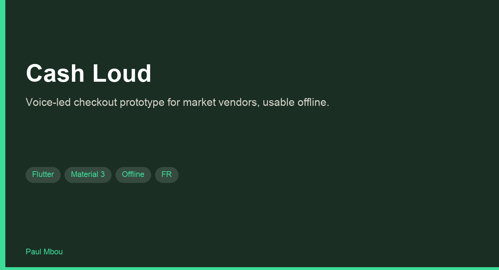

# Cash Loud

**Voice-led checkout for a market stall, designed to work offline.**
Prototype de caisse pour un vendeur en Afrique francophone : la vente se confirme à la voix, le stock reste sur l’appareil.



## What it does

- Home register with a listening state and a sale confirmation
- Sales list
- Stock
- A “plus” page for the rest of the stall tools

The voice path is an interface (écoute, confirmation, retour visuel). This build does not ship a speech-recognition engine yet. Amounts and labels are in French.

## Stack

Flutter, Material 3, a small local theme, Lucide icons.

## Run

```bash
flutter pub get
flutter run
```

## Author

Paul Mbou — [github.com/paul-mbou](https://github.com/paul-mbou)
